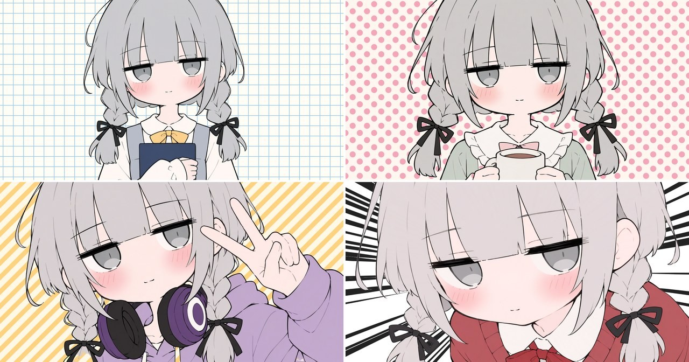
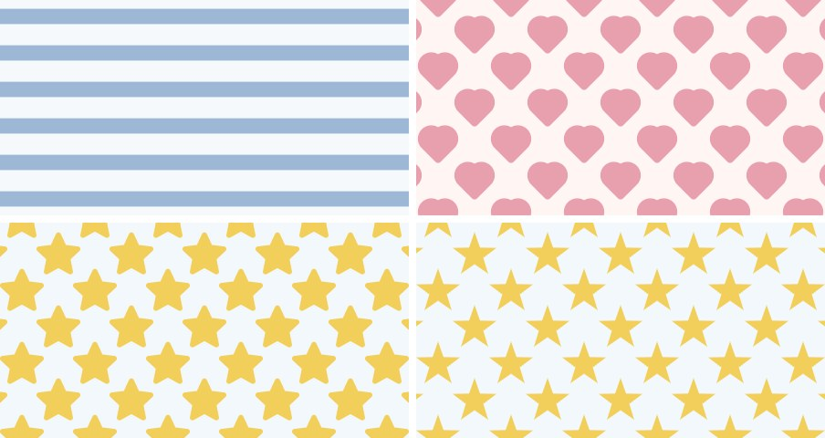
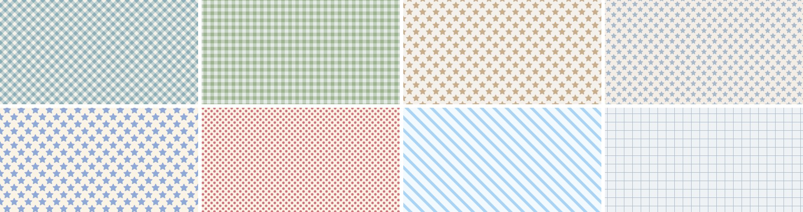
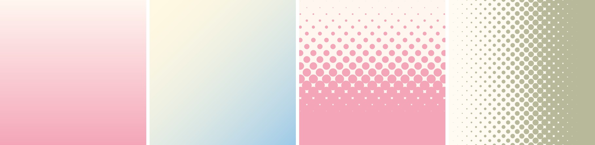
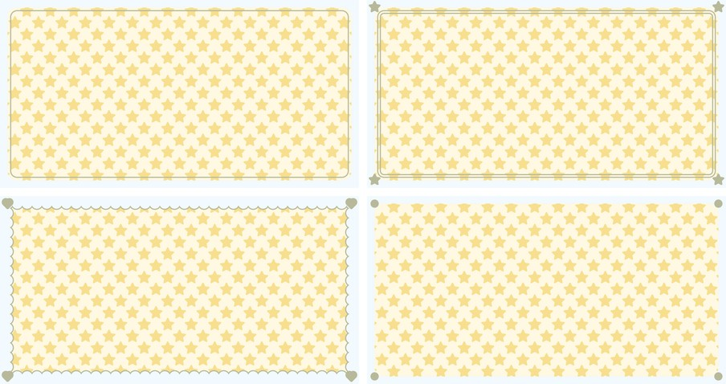
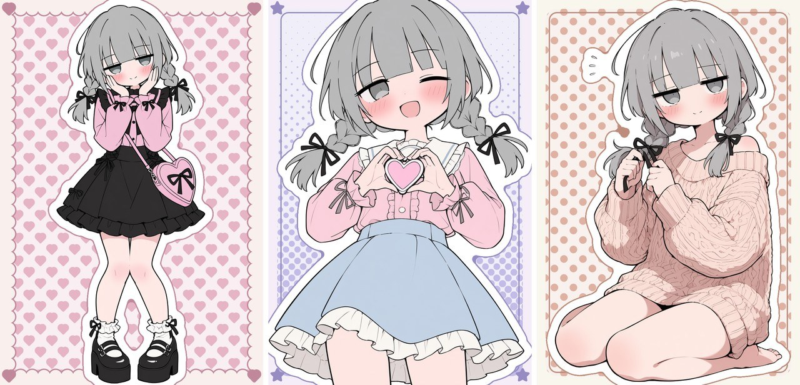

# ComfyUI-PatternBackground

ComfyUI nodes that draw flat pattern backgrounds and frames for compositing a character cut out with the core
`Remove Background` node: solid, dots, stripes, border, grid, gingham, checkerboard, manga-style focus lines, hearts,
stars, gradient and halftone. A sticker node adds a die-cut border (white by default) around the cut-out character. The pattern and its colors can be left to a seed, picked from cute palettes or from the character's own colors.

The patterns are drawn mathematically (no model, no extra dependencies), so they are instant and identical every time.




A character cut out with `Remove Background` (ToonOut) and composited on `Pattern Background`.
The character in this image is not covered by the MIT license. Please do not reuse it.

## Install

Clone into `ComfyUI/custom_nodes/` and restart ComfyUI.

```
cd ComfyUI/custom_nodes
git clone https://github.com/pudu-puda/ComfyUI-PatternBackground
```

To update: `git pull` in `ComfyUI/custom_nodes/ComfyUI-PatternBackground`, then restart ComfyUI.
Workflows made with 0.1 and 0.2 keep working and give the same images (the new inputs are optional and default to off),
as long as the image is within the new size limit below.

## Node: Pattern Background (`image/pattern`)

| Input | Meaning |
|---|---|
| `pattern` | `solid`, `dots`, `stripes`, `grid`, `gingham`, `checkerboard`, `focus_lines`, `border`, `hearts`, `stars`, `gradient`, `halftone` |
| `width`, `height` | Output size. Ignored when `size_from` is connected |
| `color`, `background` | Pattern color and base color, `#RRGGBB` |
| `spacing` | Repeat interval in px |
| `thickness` | Size relative to `spacing` (dot diameter, stripe / line width, heart / star width). For `focus_lines`, line width |
| `angle` | Rotation in degrees (45 = diagonal stripes). `gradient`, `halftone`: the direction of the change (0 = left to right, 90 = top to bottom) |
| `stagger` | `dots`, `hearts`, `stars`, `halftone`: offset every other row |
| `lines`, `inner_radius`, `center_x`, `center_y` | `focus_lines` only |
| `seed` | `focus_lines`: randomness. With `randomize` on: what gets picked |
| `size_from` (optional) | Take width and height from this image (e.g. the character image) |
| `roundness` (optional) | `hearts`, `stars`: 0 = the sharp mathematical shape, 1 = round tips and dips (default 0.6) |
| `randomize` (optional) | `off` (default), `colors` (pick the two colors by seed), `pattern_and_colors` (also the pattern, spacing, thickness and angle, within ranges that look good; solid and focus lines are not picked) |
| `palette` (optional) | Where random colors come from: `any`, a group (`muted`, `pastel`, `retro`), one of 12 palettes, `from_character`, or `random_rgb` (no palette, for comparison) |
| `harmony` (optional) | `from_character` only: `same` (the character's main color, pale), `neighbor` (30° to either side), `complement` (the opposite hue), `accent` (the character's second color as the pattern), `auto` (by seed) |
| `subject_mask` (optional) | `from_character`: the character's mask (e.g. from `Remove Background`). Without it, near-white pixels are skipped |

Outputs: `image`, `pattern_mask` (where the pattern color is), `palette` (the colors used, for `Pattern Frame`), and
`settings` (the main settings used, as text: pattern, colors, spacing, thickness, angle, stagger, roundness, palette,
seed; connect it to the core `Preview as Text` to see what `randomize` picked).
With `randomize: colors`, only `color` and `background` are replaced; with `pattern_and_colors`, `pattern`,
`spacing`, `thickness`, `angle` and `stagger` are replaced too. The replaced widgets are not used.
The same seed and settings (and, for `from_character`, the same character image and mask) always give the same
background.
Sizes above 4096×4096 pixels in total are refused (to avoid running out of memory).





`gradient` blends `background` into `color` along `angle`; `thickness` moves the middle of the blend (0.5 = even,
larger = more of the picture leans to `color`). `halftone` is a grid of dots that grow along `angle`: `spacing` is the
dot interval and `thickness` the size of the largest dot. `randomize: pattern_and_colors` does not pick these two, so
seeds from 0.2 give the same backgrounds.



### Colors from the character (`palette: from_character`)

Set `randomize` to `colors` or `pattern_and_colors` and `palette` to `from_character` (with `randomize: off` the
two color widgets are used as they are). Connect the character image to `size_from` and its mask to `subject_mask`.
Inside the mask, low-color pixels (grey,
white, black) and pale skin are skipped; the rest (clothes, props, colored hair) is counted by hue. The largest group is
the main color, a smaller group at least 45° away is the accent. The two background colors keep a fixed light,
soft tone (paler than the character) and take their hue from the harmony. Nothing is specific to one character.


The character in this image is not covered by the MIT license. Please do not reuse it.

## Node: Pattern Frame (`image/pattern`)

A frame over the edge of an image: `rounded` (rounded window and a thin line), `double_line`, `scallop` (a row of
round bumps), `plain`; optional `hearts`, `stars` or `dots` on the four corners. Connect `palette` from
`Pattern Background` to take the frame and line colors from the background. With `randomize`, the style and corner
motif are picked by `seed`.



Tip: frame the background first and paste the character last, so the character stays in front of the frame.

## Node: Pattern Sticker (`image/pattern`)

A die-cut sticker border around a cut-out character: the character's mask grown by `width` px into a round-cornered
"paper" shape, with an optional thin outline around it. Composite it last, over the background and frame.

| Input | Meaning |
|---|---|
| `image`, `mask` | The character image and its mask (e.g. from `Remove Background`) |
| `width` | Border width in px (0 = no border) |
| `color` | Border color, `#RRGGBB` (white by default) |
| `outline_width`, `outline_color` | A thin line around the border (0 = none) |
| `color_mode`, `outline_color_mode` | `manual` (the color above), `from_palette` (from `Pattern Background`'s palette), `from_character` (the character's main color: pale for the border, mid-tone for the outline) |
| `fill_holes` | Background enclosed by the border (inside a ribbon loop, between an arm and the body): `small` (fill the narrow ones the border nearly closes), `none` (keep them as windows), `all` (fill all) |
| `smooth` | Rounds the inside corners of the border (share of `width`) |
| `palette` (optional) | From `Pattern Background`, for the `from_palette` modes |

Outputs: `image` (the character on the sticker paper) and `mask` (the sticker's shape). A body cut off by the image
edge gets no border line along that edge. The border is worked out on the image plus a margin of about
`width × (1 + smooth) + outline_width` px on each side; when that area is above 4096×4096 pixels in total, the node
refuses it (lower `width` or `smooth`, or use a smaller image).



The character in this image is not covered by the MIT license. Please do not reuse it.

## Node: Load BiRefNet Checkpoint (ToonOut etc.) (`image/background removal`)

Loads an original BiRefNet checkpoint for the core `Remove Background` node, without converting it.
[ToonOut](https://huggingface.co/joelseytre/toonout) (BiRefNet fine-tuned on anime characters, MIT) is distributed as
`birefnet_finetuned_toonout.pth`, whose weight names start with `module._orig_mod.`. The core
`Load Background Removal Model` does not recognise them; this node strips the prefixes and hands the weights to the
core loader. Files are read through ComfyUI's `load_torch_file` (`.pth` with `weights_only=True`).

Put the file in `ComfyUI/models/background_removal/` and select it.

## Typical use

Character image → `Remove Background` (mask)
→ `Pattern Background` (`size_from` = character, `subject_mask` = mask)
→ `Pattern Frame` (`image` = background, `palette` = background's palette)
→ `ImageCompositeMasked` (destination = framed background, source = character, mask = mask).

With a sticker: character + mask → `Pattern Sticker` → `ImageCompositeMasked` (destination = framed background,
source = sticker image, mask = sticker mask).

## 日本語

キャラクターを ComfyUI 標準の `Remove Background` で切り抜いて重ねるための、平らな柄の背景と枠を作るノードです。柄は無地・ドット・ストライプ・ボーダー・方眼・ギンガムチェック・市松・集中線・ハート・星・グラデーション・ハーフトーン。計算で描くので、生成 AI を使わず一瞬で、毎回同じ柄が出ます。追加のライブラリは要りません。

- `randomize` で、柄と色を seed の番号でおまかせにできます（同じ番号なら同じ背景）。`colors` は色だけ、`pattern_and_colors` は柄・間隔・太さ・角度も選びます。色はパレット（くすみ・パステル・レトロ）から選ぶか、`from_character` でキャラの服や小物の色から決めます（同系色・となりの色・補色・差し色）。特定のキャラ専用の決まりは入っていないので、どのキャラでも絵と切り抜きのマスクをつなげば使えます。
- `Pattern Frame` は枠のノードです。背景のノードの `palette` をつなぐと、枠の色が背景に合います。背景に枠を付けてからキャラを重ねると、キャラが枠の手前に出ます。
- `Pattern Sticker` は、切り抜いたキャラの周りにステッカーのようなふち（既定は白）を付けるノードです。外側の細い線、背景やキャラの色から選ぶ色、リボンの輪の中などのすき間の埋め方を選べます。背景と枠のあとに、最後に重ねます。
- アニメ絵向けの切り抜きモデル ToonOut の配布ファイル（.pth）をそのまま読む `Load BiRefNet Checkpoint` も入っています。
- 0.1・0.2 で作ったワークフローはそのまま動き、同じ画像が出ます。

例の画像（examples/composite.jpg、examples/from_character.jpg、examples/sticker.jpg）のキャラクターは MIT ライセンスの対象外です。転用しないでください。

## License

MIT (code and the pattern-only images `examples/patterns.jpg`, `new_patterns.jpg`, `random.jpg`, `frames.jpg`, `gradient_halftone.jpg`).
The character in `examples/composite.jpg`, `examples/from_character.jpg` and `examples/sticker.jpg` is not covered by the MIT license.
Please do not reuse it.
