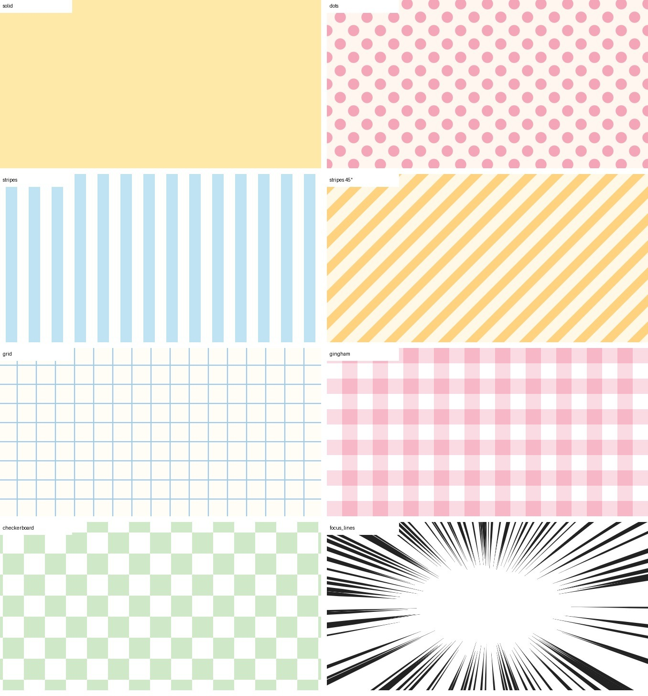

# ComfyUI-PatternBackground

A ComfyUI node that draws flat pattern backgrounds — solid, dots, stripes, grid, gingham, checkerboard and manga-style focus lines — for compositing a character cut out with the core `Remove Background` node.

The patterns are drawn mathematically (no model, no extra dependencies), so they are instant and identical every time.



## Install

Clone into `ComfyUI/custom_nodes/` and restart ComfyUI.

```
cd ComfyUI/custom_nodes
git clone https://github.com/pudu-puda/ComfyUI-PatternBackground
```

## Node: Pattern Background (`image/pattern`)

| Input | Meaning |
|---|---|
| `pattern` | `solid`, `dots`, `stripes`, `grid`, `gingham`, `checkerboard`, `focus_lines` |
| `width`, `height` | Output size. Ignored when `size_from` is connected |
| `color`, `background` | Pattern color and base color, `#RRGGBB` |
| `spacing` | Repeat interval in px |
| `thickness` | Size relative to `spacing` (dot diameter, stripe / line width). For `focus_lines`, line width |
| `angle` | Rotation in degrees (45 = diagonal stripes) |
| `stagger` | `dots`: offset every other row |
| `lines`, `inner_radius`, `center_x`, `center_y`, `seed` | `focus_lines` only |
| `size_from` (optional) | Take width and height from this image (e.g. the character image) |

Outputs: `image`, and `pattern_mask` (where the pattern color is).

## Node: Load BiRefNet Checkpoint (ToonOut etc.) (`image/background removal`)

Loads an original BiRefNet checkpoint for the core `Remove Background` node, without converting it.
[ToonOut](https://huggingface.co/joelseytre/toonout) (BiRefNet fine-tuned on anime characters, MIT) is distributed as
`birefnet_finetuned_toonout.pth`, whose weight names start with `module._orig_mod.`. The core
`Load Background Removal Model` does not recognise them; this node strips the prefixes and hands the weights to the
core loader. Files are read through ComfyUI's `load_torch_file` (`.pth` with `weights_only=True`).

Put the file in `ComfyUI/models/background_removal/` and select it.

## Typical use

`Pattern Background` → `ImageCompositeMasked` (destination) ← character image (source) + `Remove Background` mask
(`Load BiRefNet Checkpoint` with ToonOut, or the core `Load Background Removal Model`).

## 日本語

キャラクターを ComfyUI 標準の `Remove Background` で切り抜いて重ねるための、平らな柄の背景を作るノードです。アニメ絵向けの切り抜きモデル ToonOut の配布ファイル（.pth）をそのまま読む `Load BiRefNet Checkpoint` も入っています。無地・ドット・ストライプ・方眼・ギンガムチェック・市松・集中線から選べます。計算で描くので、生成 AI を使わず一瞬で、毎回同じ柄が出ます。追加のライブラリは要りません。

## License

MIT
